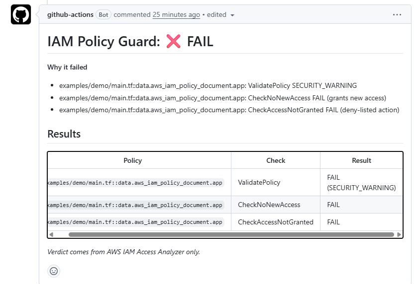
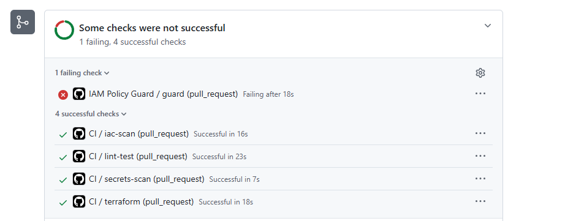
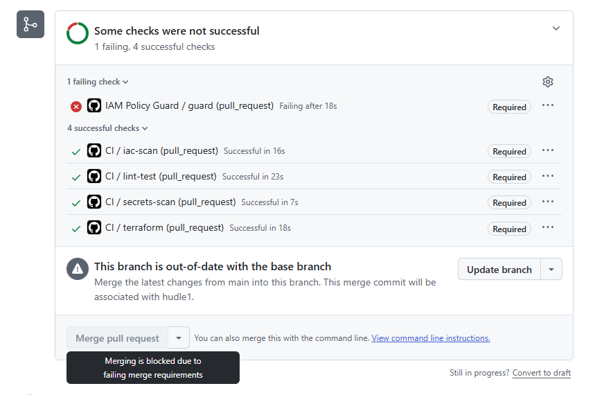

# IAM Policy Guard [](https://github.com/hudle1/iam-policy-guard/actions/workflows/ci.yml)

A GitHub Action that runs AWS IAM Access Analyzer against every Terraform IAM change in a pull request and blocks the merge if the change grants risky or new access. Access Analyzer decides pass/fail. An advisory LLM explanation is planned for v1.1, and it will never be able to overrule the verdict.

**Status: v1 shipped.**

## Why this matters
Overly broad IAM policies are one of the most common root causes in cloud breaches, and they usually arrive through ordinary pull requests that reviewers skim. Static linters catch syntax and obvious wildcards, but not "this change quietly grants new access." Access Analyzer's custom policy checks answer that question with automated reasoning. The missing piece is explaining the finding in plain language at review time, which is where an LLM helps, as long as it can't overrule the deterministic check.

## Demo
Live demo: [PR #7](https://github.com/hudle1/iam-policy-guard/pull/7) adds `iam:PassRole` on `"*"` to `examples/demo/main.tf`. It is intentionally left open and never merged.


*The bot comment: all three Access Analyzer checks fail on the risky statement.*


*The guard fails while CI passes, so the problem is the IAM change, not the code.*


*With the `main` ruleset, all five checks are required and the merge button is blocked.*

## Architecture
See [docs/architecture.md](docs/architecture.md).

## How it works
1. The workflow runs on every PR, via `pull_request` (never `pull_request_target`). With no changed `.tf` files it checks nothing and passes.
2. The job gets short-lived AWS credentials via GitHub OIDC. No access keys exist.
3. IAM policy documents are extracted statically (python-hcl2, no `terraform plan`) from the changed `.tf` files at the base and head commits: `data "aws_iam_policy_document"` blocks and inline policies written as a JSON heredoc or JSON string. Files under the exclude list (default `tests/fixtures/`) are skipped and listed in the report.
4. For each new or changed policy, Access Analyzer runs `ValidatePolicy`, `CheckNoNewAccess` (head vs base; skipped for brand-new policies) and `CheckAccessNotGranted` (deny list). Documents with a `Principal` (role trust policies) are checked as resource policies, and the deny-list check is skipped for them. Policies identical to base aren't re-checked.
5. The verdict comes from those results only, and it fails closed: a policy it can't read (`jsonencode`, `file()`, variables), any API error, or more than 20 changed policies is a FAIL. The job's exit code is the gate.
6. Claude gets the policy and findings as untrusted data and writes an advisory explanation and suggested rewrite. This section appears only when `ANTHROPIC_API_KEY` is set; the LLM call itself is not implemented yet.
7. The report is posted as a single PR comment that's updated on each run (`gh pr comment --edit-last --create-if-none`).

## Security design
- **OIDC role scoped to one repo + `pull_request` only.** The `sub` claim must match exactly, sessions last 1 hour, and the role is locked to one Region. No access keys exist.
- **Immutable OIDC subject.** The trust policy matches `repo:OWNER@OWNER_ID/REPO@REPO_ID:pull_request`. Numeric IDs are never reused, so if the repo or account were renamed or deleted, a new repo with the same name couldn't take over the role.
- **Three permissions total**, all Access Analyzer policy checks, each documented in `infra/main.tf`.
- **`allowed_account_ids`** pins the Terraform provider to the sandbox account, so `plan` and `apply` refuse to run anywhere else.
- **Fail closed.** The run FAILs on policies it can't read (`jsonencode`, `file()`, variables), on any Access Analyzer or git error, and when more than 20 policies change. Nothing unchecked passes silently.
- **Fork PRs fail closed.** They get no AWS credentials, so the `guard` job fails before checkout with a clear message instead of being skipped. A skipped required check would count as passing.
- **A real merge gate.** A ruleset on `main` requires a PR and five status checks (`guard`, `lint-test`, `terraform`, `secrets-scan`, `iac-scan`) in strict mode, so the branch must be up to date. It also blocks force pushes and deletion. Each check is pinned to the GitHub Actions app, so no other app or token can post a fake passing `guard` status.
- **No sensitive data in PR comments.** AWS errors are reported by error code only; their messages can contain the role ARN and account ID. Policy IDs are file paths chosen by the PR author, so they're escaped as inline code to block markdown or link injection.
- **The verdict is deterministic.** `verdict.py` cannot import LLM code, and a test enforces it. When the AI explanation arrives in v1.1, PR content will be treated as untrusted input to the model.
- **No `terraform apply` on PRs**, so the workflow can't change infrastructure.
- Secret scanning + push protection, Checkov, Gitleaks, Dependabot.

Full analysis: [docs/threat-model.md](docs/threat-model.md).

## Known limitations
- **Terraform references aren't resolved.** Extraction is static, so a policy built from variables, locals, `jsonencode()` or `file()` can't be read. Those policies fail closed, and the report asks for a literal `aws_iam_policy_document` block or a JSON heredoc.
- **`infra/` is excluded.** The guard's own bootstrap role is written with references (the OIDC provider ARN, variables), so it would always fail closed. The workflow passes `--exclude infra/`, and those files are listed as skipped in every report rather than silently ignored.

## Quick start
New to AWS? Start with the full [setup guide](docs/setup-guide.md): account creation, root lockdown, SSO, and tools, with the pitfalls called out.

```bash
# 1. Deploy the OIDC role into a sandbox account (use an SSO profile, not access keys)
cd infra
cp terraform.tfvars.example terraform.tfvars   # edit values
terraform init && terraform apply
# 2. In GitHub: Settings > Secrets and variables > Actions
#    Secret   AWS_ROLE_ARN = <role_arn output>
#    Secret   ANTHROPIC_API_KEY
# 3. Open a PR that widens examples/demo/main.tf (e.g. add "iam:PassRole" on "*")

# Teardown
terraform destroy
```

## Cost
- **Measured:** about **$0.002–0.004 per PR** that changes a policy (one or two paid checks per policy; `ValidatePolicy` is free), and **$0** for PRs without policy changes, which make no Access Analyzer calls.
- Pricing: `CheckNoNewAccess` and `CheckAccessNotGranted` are $0.002 per call. IAM roles, the OIDC provider and the STS sign-in are free.
- Anthropic API: none in v1. Token cost will be recorded when the AI explanation ships.
- Total for this project: well under $1/month, with a $10 budget alarm.

## What I'd do in production
- **Extract from `terraform plan` JSON** (`terraform show -json`) instead of static HCL parsing, so variables, modules and references resolve. That requires read-only provider credentials in CI.
- **An org-wide deny-list config**, owned by the security team, versioned centrally and shared by every repo instead of hard-coded per repo.
- **Pin every action to a full commit SHA**, with Dependabot proposing updates, so a moved tag can't change what runs.
- **Required reviewers plus CODEOWNERS** for `.github/workflows/` and `infra/`, so nobody can change the gate or its role without security review.
- **Multi-Region IAM Identity Center**, so human access to the accounts survives a Regional outage.

## Roadmap
- **v1.1: AI explanation.** Claude explains failing findings in plain language and suggests a least-privilege rewrite, with prompt-injection defenses: PR content delimited and treated as data, length caps, IDs redacted, and output never parsed into a decision.
- **Rename detection** (`git diff -M`): a renamed `.tf` file currently looks like a brand-new policy, so it loses its baseline and skips `CheckNoNewAccess`. Pair old and new paths so renamed files keep their baseline.
- **Reference resolution**: read policies from `terraform plan` JSON, or substitute worst-case wildcards for unresolved values, so policies that use variables can be checked instead of failing closed.
- **Stricter baseline for brand-new policies**: a new policy has nothing to compare against, so today only `ValidatePolicy` and the deny list apply. Compare it against a minimal reference policy (or require an explicit approval label) instead.
- **Pin actions to SHAs** in both workflows.

v1 non-goals: resource policies (S3/KMS/SQS), SCPs, auto-fix commits, `terraform plan`-based extraction, multi-account.

## Skills demonstrated
AWS IAM, IAM Access Analyzer, least privilege, GitHub Actions, OIDC workload identity federation, Terraform, policy-as-code, shift-left security, LLM security, prompt injection mitigation, threat modeling (STRIDE), Python.
