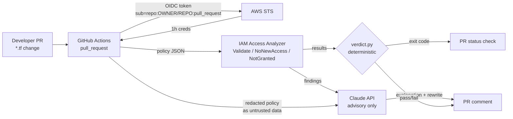

# Architecture

## Data flow
| Data | From | To | Notes |
| --- | --- | --- | --- |
| OIDC JWT | GitHub | AWS STS | Short-lived, audience `sts.amazonaws.com` |
| Policy JSON | PR head + base | Access Analyzer, Claude | Synthetic data only; redact IDs before LLM |
| Findings | Access Analyzer | verdict.py, Claude, PR comment | |
| Explanation | Claude | PR comment | Never parsed into a decision |

## Trust boundaries
1. GitHub runner ↔ AWS (OIDC)
2. GitHub runner ↔ Anthropic API
3. PR author ↔ everything (PR content is untrusted)
